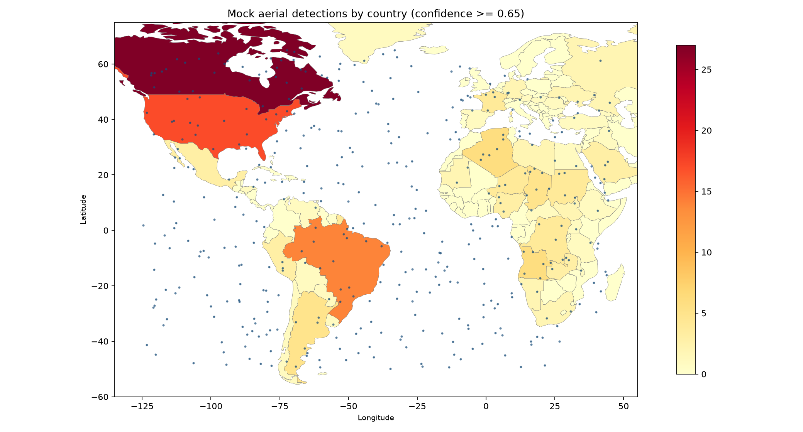
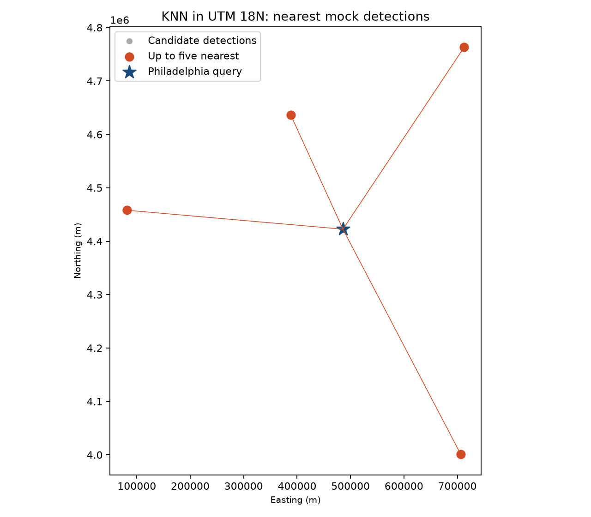

# Sedona Detect Map

Offline spatial analytics: 177 bundled country polygons, 600 mock vehicle boxes,
confidence filtering, points-in-polygon assignment, zone counts and regional KNN.
No API keys, Spark installation or runtime downloads required.

## Run

Python 3.13 tested on Windows. Install with `python -m pip install -r requirements.txt`,
then run `python demo.py`. Outputs are saved beside the script.

The run writes zone-counts.csv and nearest.csv and checks count conservation and
KNN cardinality. Example: 421 detections pass confidence >= 0.65; 147 fall inside
countries and 274 are unmatched. Four candidates exist in the regional KNN window.

## Sedona connection

This time-boxed Windows demo uses GeoPandas/Shapely instead of Apache Sedona/PySpark
to keep local setup reliable. It references Sedona concepts honestly: ST_Contains
for point assignment, detection centers, GROUP BY aggregation and distance-ordered
KNN. Distributed spatial partitioning and indexes would support larger workloads;
this project does not run Sedona or claim distributed performance.

The mock detections mirror the output shape of Muhammad Abdulrehman's real
YOLO/RF-DETR detector training pipeline; no model inference is performed here.

## Data and assumptions

countries.geojson is Natural Earth public-domain country data bundled from
https://github.com/python-visualization/folium/blob/main/examples/data/world-countries.json .
Terms: https://www.naturalearthdata.com/about/terms-of-use/ . Boundaries are coarse
cartographic references, not authoritative borders.

detections.json is synthetic (Python Random seed 42): 600 boxes sampled uniformly
in longitude -125..45 and latitude -50..65, with mock confidence 0.5..1.0.
Schema: id, label, confidence, bbox [west, south, east, north]. These are not real
vehicles or image-derived detections. Counts assign box midpoints using strict
within; ocean and boundary points remain unmatched. Tile deduplication is omitted.
The overview uses lon/lat. KNN searches up to five points within -80..-70, 35..45,
using UTM 18N metric distances from Philadelphia. It is a regional illustration,
not a global geodesic nearest-neighbor service.

Author: Muhammad Abdulrehman <muhammadabdulrehman513@gmail.com>
